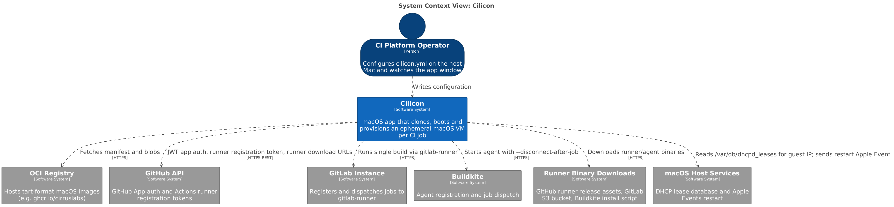
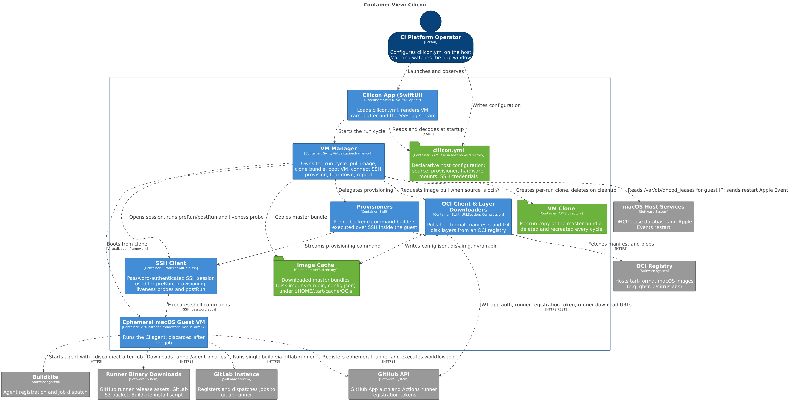
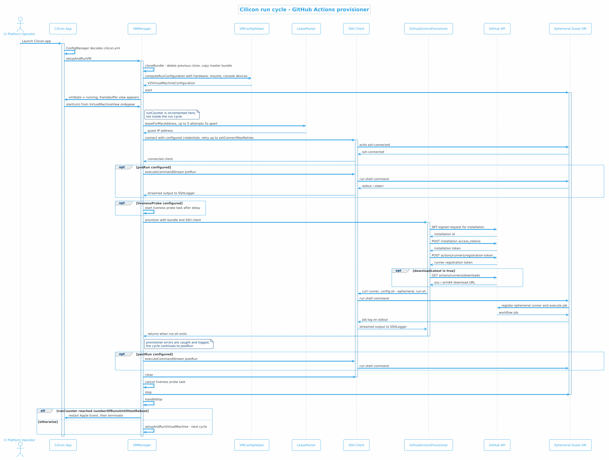
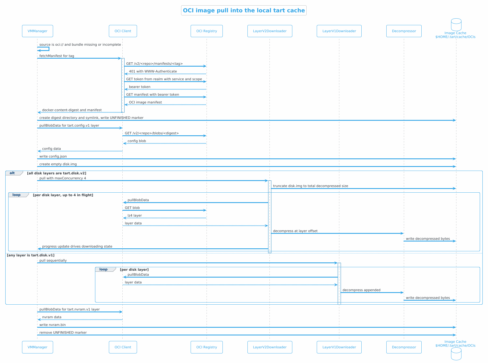
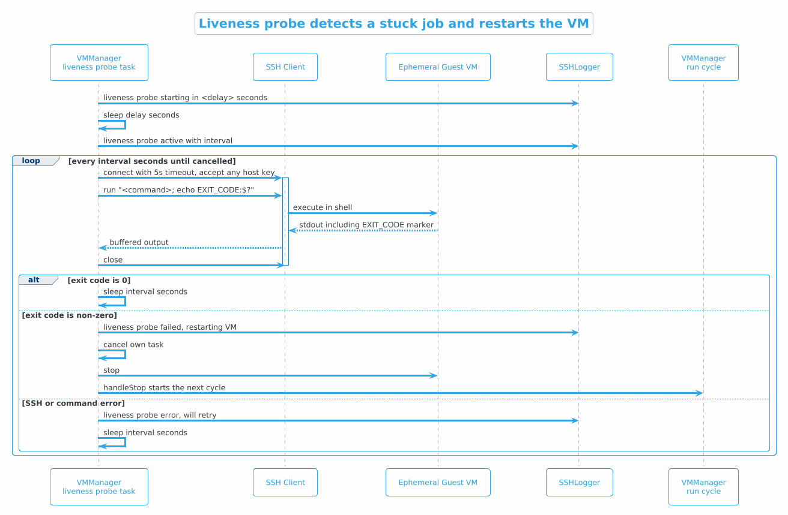
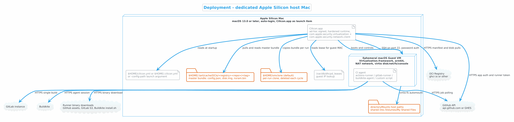

# Cilicon — System Architecture

## Document Metadata

| Field | Value |
|-------|-------|
| **Document ID** | `[PENDING CLARIFICATION — no IA.XX.YY identifier exists in the repository; needs the Confluence IA record for "cilicon"]` |
| **System Name** | Cilicon — Self-Hosted macOS CI on Apple Silicon |
| **Asset Classification** | `[PENDING CLARIFICATION — asset classification lives in the IA Overview, not in this repository]` |
| **Repository** | https://github.com/traderepublic/Cilicon |
| **Owner** | `atom-mobile-platform` |
| **Document Owner** | `[PENDING CLARIFICATION — no document owner recorded in the repository; CODEOWNERS names the team, not an individual]` |
| **Last Review Date** | 2026-09-14 |
| **Status** | Draft |
| **Confidentiality** | Public — the repository is a public open-source project under the licence in LICENSE.md |

Component lifecycle is declared as `production` and type `service` in the Backstage catalog entry.

_Sources: catalog-info.yaml, CODEOWNERS, README, LICENSE, project.pbxproj._

### Related Documents

| Relationship | Document |
|--------------|----------|
| Parent System | `[PENDING CLARIFICATION — no parent system declared in catalog-info.yaml or elsewhere in the repository]` |
| Child Systems | None. Cilicon is a single macOS application target with one test target. |
| Key ADRs | None. The repository contains no `docs/adr` directory and no ADR files. |
| Runbooks | No runbook directory exists. Host setup instructions live in the "Setting Up the Host OS" section of README. |

_Sources: catalog-info.yaml, README, project.pbxproj._

---

## 1. Overview

### What It Does

Cilicon turns a dedicated Apple Silicon Mac into a self-hosted CI runner host. It boots a throwaway macOS virtual machine, registers a CI agent inside it, waits for that agent to finish exactly one job, then destroys the VM and starts a fresh one. GitHub Actions, GitLab Runner, Buildkite Agent and arbitrary shell scripts are supported as CI backends.

_Sources: README, VMManager, ProvisionerConfig._

### Why It Exists

**The Problem**: macOS and Xcode builds cannot run on the Linux container infrastructure that carries the rest of CI, and they must run on Apple hardware. Running them directly on a shared physical Mac leaks state between jobs — caches, keychains, provisioning profiles, simulator state and anything a build script writes — which makes builds non-reproducible and makes the host a long-lived target for whatever a build happens to execute.

**The Solution**: Cilicon gives every CI job a virtual machine cloned from a known-good image, and deletes that clone when the job ends. Apple's Virtualization framework provides near-native performance on Apple Silicon, so the isolation does not cost a usable build time.

_Sources: README, VMManager, VMConfigHelper+RunConfig._

### How It Works (Simplified)

1. On launch the app reads `cilicon.yml` from the host home directory and decides where the base VM image comes from — a local path or an OCI registry.
2. If the image is not already in the local cache, the built-in OCI client downloads and decompresses it into `~/.tart/cache/OCIs`.
3. The app copies the cached image to a clone path, boots that clone as a VM, and finds the guest's IP address in the host DHCP lease file.
4. It connects over SSH and runs the configured provisioner, which installs and starts a CI agent inside the guest. The provisioner call blocks until the agent exits — which for an ephemeral agent means the job is finished.
5. The VM is stopped, the clone is deleted, and the cycle restarts. After a configurable number of runs the app restarts the host Mac instead.

_Sources: ConfigManager, VMManager, VMSource, LeaseParser, Provisioner._

### Key Concepts

| Term | Definition |
|------|------------|
| Cilicon cycle | One full iteration of clone → boot → provision → run one job → destroy, repeated indefinitely by `VMManager::handleStop`. |
| Master bundle | The read-only base image, a directory holding `disk.img`, `nvram.bin` and `config.json`. Never booted directly. |
| Clone | The per-run writable copy of the master bundle, created at `vmClonePath` and deleted at the start of the next cycle. |
| Provisioner | A strategy object that turns a CI backend into one shell command run over SSH inside the guest; implementations exist for GitHub Actions, GitLab, Buildkite and raw scripts. |
| tart image format | The on-disk and OCI layout used by Cirrus Labs' `tart`, which Cilicon reads so it can consume publicly published macOS images. Layer media types are `application/vnd.cirruslabs.tart.*`. |
| Ephemeral runner | A CI agent configured to accept exactly one job and then exit, which is what makes "one VM per job" work — `--ephemeral` for GitHub, `--max-builds 1` for GitLab, `--disconnect-after-job` for Buildkite. |
| Liveness probe | A periodic SSH command that checks the agent is still alive inside the guest; a non-zero exit restarts the VM. |

_Sources: VMManager, VMBundle, Provisioner, GithubActionsProvisioner, GitLabRunnerProvisioner, BuildkiteAgentProvisioner, LivenessProbeConfig, README._

---

## 2. Context & Scope

### System Context Diagram

### Stakeholders

| Stakeholder | Role | Concern |
|-------------|------|---------|
| CI platform operators (`atom-mobile-platform`) | Operator, decision maker | Host fleet stays in the cycle; images stay current; `cilicon.yml` and the GitHub App private key are correct on each host. |
| Mobile engineers running CI jobs | Indirect users | Jobs get picked up, run on a clean machine, and produce readable logs. |
| Anyone whose workflow runs in the guest | Indirect users | Whatever the job needs (Xcode version, mounted directories) is present in the image or the mount config. |
| External adopters | Users | The project is public and the README is written as an adoption guide, so third parties run this code on their own hardware. |

Inferred: the stakeholder list is derived from CODEOWNERS, the Backstage owner field and the audience the README addresses. The repository contains no stakeholder register.

_Sources: CODEOWNERS, catalog-info.yaml, README._

### Business Constraints

| Constraint | Description | Impact on Architecture |
|------------|-------------|----------------------|
| Apple licensing and hardware | macOS guests may only be virtualised on Apple hardware, and Apple's Virtualization framework permits at most two concurrent VMs per host. | One VM per host process; the README lists "running 2 VMs in parallel" as future work rather than current behaviour. |
| Apple Silicon only | The image config accepts only `arm64` / `darwin`, and the release build pins `ARCHS=arm64`. | No Intel host or guest support. |
| macOS 13.0 minimum on the host | `MACOSX_DEPLOYMENT_TARGET = 13.0`. | Rules out older host fleet. |
| Known SSH defect on macOS 15.0–15.3.x | README warns the swift-nio-based SSH stack is unreliable on those versions and asks for 15.4+. | Constrains which host OS versions the fleet may run. |

Beyond these, no regulatory, contractual or SLA constraint is stated anywhere in the repository. `[PENDING CLARIFICATION — if Cilicon is in scope for DORA/BaFin control requirements as CI infrastructure, that determination lives in the IA record, not here.]`

_Sources: README, VMConfig, project.pbxproj, build_release.yml._

---

## 3. Architecture

### Container Diagram

### Component Description

Cilicon is one process. The "containers" above are the internal modules and the on-disk artefacts they own, not separately deployable units.

#### 3.1 Cilicon App (SwiftUI shell)

| Attribute | Value |
|-----------|-------|
| **Description** | `@main` SwiftUI `App` with a single window. Builds a `ConfigManager` on first render; on success it shows `ContentView`, on failure it renders the decoding error as text. |
| **Technology** | Swift 6.0, SwiftUI, AppKit, Virtualization |
| **Repository** | https://github.com/traderepublic/Cilicon |
| **Deployment** | `Cilicon.app`, launch item on a dedicated host Mac |

`ContentView` owns the `VMManager` and switches its body on `VMManager::vmState`: download progress, "Copying Image", the live VM framebuffer plus the SSH log, an error string, or the legacy-image conversion prompt. Two side effects live in the view rather than the manager — `onAppear` kicks off `setupAndRunVM`, and the `VirtualMachineView`'s own `onAppear` calls `VMManager::start`, which is where `runCounter` is incremented. On `NSApplication.willTerminateNotification` the view calls `VMManager::cleanup`, which cancels the liveness probe and deletes the clone.

**Data Handled**:

| Data Type | Classification | Storage |
|-----------|---------------|---------|
| Guest console/SSH output, including whatever a CI job prints | Internal; may contain build secrets echoed by a job | In memory only, capped at the most recent 500 log chunks in `SSHLogger` |
| Guest IP address | Internal | In memory, shown in the window title |

**Interfaces Exposed**: none. There is no HTTP server, no IPC endpoint and no CLI subcommand — the only input surfaces are the `cilicon.yml` file and the `-config-path` launch argument read via `UserDefaults`.

_Sources: CiliconApp, ContentView, VirtualMachineView, SSHLogger, ANSIParser, ConfigManager, VMManager._

#### 3.2 VM Manager

| Attribute | Value |
|-----------|-------|
| **Description** | `@MainActor` `ObservableObject` that owns the whole lifecycle: image acquisition, cloning, boot, IP discovery, SSH, provisioning, teardown and restart. Also the `VZVirtualMachineDelegate`. |
| **Technology** | Swift 6.0, Virtualization.framework, Citadel SSH |
| **Repository** | https://github.com/traderepublic/Cilicon |
| **Deployment** | In-process |

`setupAndRunVM` is the entry point and is also the error boundary: any thrown error sets `vmState = .failed`, sleeps `retryDelay` seconds (default 5) and calls itself recursively. `setupAndRunVirtualMachine` is the per-cycle body. `handleStop` decides between another cycle and `AppleEvent.restart` + `NSApplication.terminate` once `runCounter` reaches `numberOfRunsUntilHostReboot`. Both delegate callbacks — `didStopWithError` and `guestDidStop` — cancel the liveness probe and route into `handleStop`, so a guest that shuts itself down also advances the cycle.

VM hardware is assembled by `VMConfigHelper` and its `computeRunConfiguration` extension: virtio block device on the clone's `disk.img`, virtio NIC with NAT attachment and the MAC address stored in the bundle's `config.json`, USB keyboard and pointing device, a Mac graphics device sized from `hardware.display`, optional host audio, one virtio-fs share carrying all `directoryMounts` under the guest automount tag, and one virtio console device per entry in `consoleDevices`.

**Data Handled**:

| Data Type | Classification | Storage |
|-----------|---------------|---------|
| Guest disk image (clone) | Internal; contains whatever the job wrote | `vmClonePath`, default `~/vmclone`, deleted each cycle |
| Guest NVRAM and machine identity | Internal | `nvram.bin` / `config.json` inside master bundle and clone |
| SSH username and password | Credential | Read from `cilicon.yml`, held in memory; defaults to `admin`/`admin` |

**Dependencies** (internal):

| Dependency | Purpose | Failure Impact |
|------------|---------|----------------|
| `OCI` + layer downloaders | Fetch the master bundle when `source` is `oci://` | Throws; cycle enters `.failed` and retries after `retryDelay` |
| `LeaseParser` | Resolve guest IP from `/var/db/dhcpd_leases` | Five attempts 5s apart, then throws into the retry loop |
| `SSHClient` (Citadel) | Run preRun, provisioning, probe, postRun | `sshConnectMaxRetries` attempts (default 10), then `sshConnectTimeout` |
| `Provisioner` | Register and run the CI agent | Error is caught and logged, not rethrown; the cycle proceeds to postRun and teardown |

_Sources: VMManager, VMConfigHelper, VMConfigHelper+RunConfig, VMBundle, LeaseParser, AppleEvents, Config._

#### 3.3 OCI Client & Layer Downloaders

| Attribute | Value |
|-----------|-------|
| **Description** | Minimal read-only OCI distribution client plus two disk-layer download strategies. Pulls a manifest, the tart config layer, the disk layers and the NVRAM layer. |
| **Technology** | Swift, URLSession, Apple `Compression` (lz4) |
| **Repository** | https://github.com/traderepublic/Cilicon |
| **Deployment** | In-process |

`OCI::request` and `OCI::download` handle registry auth by reacting to a `401`: they parse the `WWW-Authenticate` challenge, exchange it for a bearer token at the advertised realm, and retry once. `OCIURL` splits `oci://host/path:reference` on the first `:` in the path and maps it to the cache path `~/.tart/cache/OCIs/<registry><repository>/<reference>`, which `VMManager::downloadFromOCI` creates as a symlink to a digest-named directory. Because everything after the first `:` becomes the reference, `oci://host/repo:sha256:<digest>` pins by digest as well as by tag. An `UNFINISHED` marker file is written before the layers are pulled and removed after, so an interrupted pull is detectable.

`LayerV2Downloader` is used when every disk layer is `tart.disk.v2`: it truncates `disk.img` to the total decompressed size and decompresses up to four layers concurrently at their computed offsets. `LayerV1Downloader` is the fallback and appends layers sequentially through a single decompressor.

**Interfaces Consumed**: `GET /v2/<repo>/manifests/<tag>` with `Accept: application/vnd.oci.image.manifest.v1+json`, and `GET /v2/<repo>/blobs/<digest>`.

_Sources: OCI, OCIURL, Manifest, Descriptor, Descriptor+Extensions, WWWAuthenticate, LayerV1Downloader, LayerV2Downloader, Decompressor, VMManager, VMSource._

#### 3.4 Provisioners

| Attribute | Value |
|-----------|-------|
| **Description** | Four implementations of a one-method protocol — `provision(bundle:sshClient:)` — each building a shell command that installs and starts a CI agent, then streaming its output into `SSHLogger` until it exits. |
| **Technology** | Swift, Citadel SSH; GitHub variant also uses SwiftJWT |
| **Repository** | https://github.com/traderepublic/Cilicon |
| **Deployment** | In-process, selected by `provisioner.type` in `cilicon.yml` |

| Provisioner | Command it runs in the guest | Ephemerality mechanism |
|-------------|------------------------------|------------------------|
| `GithubActionsProvisioner` | Optionally `curl` + untar the latest runner into `~/actions-runner`, then `config.sh --ephemeral --replace --unattended` with a registration token, then `run.sh` | `--ephemeral` |
| `GitLabRunnerProvisioner` | Optionally `curl` + `chmod` the runner binary, then `gitlab-runner run-single` with token/url/executor/max-builds, or `run-single -c <tomlPath>` | `--max-builds`, default 1 |
| `BuildkiteAgentProvisioner` | Pipes Buildkite's `install.sh` into `bash` with `TOKEN=`, then `buildkite-agent start --disconnect-after-job` with optional tags | `--disconnect-after-job` |
| `ScriptProvisioner` | The verbatim `run` block from the config | None — the operator's script decides |

Only the GitHub provisioner talks to a control-plane API itself. `GithubService` signs an RS256 JWT from the App private key via `GHAppAuthHelper`, resolves the installation (org-level, or repo-level when `repository` is set), exchanges it for an installation token, then requests a runner registration token and optionally the runner download URLs. Runner labels are assembled from the Cilicon version, the `oci` repository and tag, and any `extraLabels`.

**Data Handled**:

| Data Type | Classification | Storage |
|-----------|---------------|---------|
| GitHub App private key | Credential | Read from `privateKeyPath` on the host filesystem at each provisioning cycle |
| GitHub installation token, runner registration token | Credential, short-lived | In memory; interpolated into the SSH command line |
| GitLab runner token, Buildkite agent token | Credential, long-lived | Plaintext in `cilicon.yml`; interpolated into the SSH command line |

_Sources: Provisioner, GithubActionsProvisioner, GithubService, GHAppAuthHelper, GitLabRunnerProvisioner, BuildkiteAgentProvisioner, ScriptProvisioner, GithubProvisionerConfig, GitLabProvisionerConfig, BuildkiteAgentProvisionerConfig, ScriptProvisionerConfig._

#### 3.5 Configuration

| Attribute | Value |
|-----------|-------|
| **Description** | `ConfigManager` locates and YAML-decodes exactly one file into an immutable `Config`. Search order: the `-config-path` launch argument, then `~/cilicon.yml`, then `~/.cilicon.yml`. |
| **Technology** | Swift, Yams |
| **Repository** | https://github.com/traderepublic/Cilicon |
| **Deployment** | Host filesystem, read once at startup |

Only `provisioner` and `source` are required. Notable defaults: `vmClonePath` → `~/vmclone`, `retryDelay` → 5, `sshConnectMaxRetries` → 10, `sshCredentials` → `admin`/`admin`, `directoryMounts` → empty, `consoleDevices` → empty. When the `hardware` block is omitted entirely, `HardwareConfig.default` assigns the host's **entire** physical memory to the guest and enables audio; when the block is present, `ramGigabytes` is mandatory and `connectsToAudioDevice` defaults to `false`. `cpuCores` defaults to the host's processor count, clamped to the Virtualization framework's allowed range.

Config is read once. There is no file watcher and no reload path, so changing `cilicon.yml` requires restarting the app.

_Sources: ConfigManager, Config, HardwareConfig, DirectoryMountConfig, ProvisionerConfig, LivenessProbeConfig, VMSource, VMConfigHelper._

---

## 4. Runtime Behavior

### Key Scenarios

#### 4.1 One CI job, end to end (GitHub Actions provisioner)

**Trigger**: app launch, or the previous cycle finishing via `handleStop`.

**Actors**: operator, Cilicon app, `VMManager`, `VMConfigHelper`, `LeaseParser`, Citadel SSH client, `GithubActionsProvisioner`, GitHub API, guest VM.

**Notes**:

- The clone is deleted and re-copied at the **start** of each cycle, not at the end. A crashed process therefore leaves the last clone on disk until the next start; `cleanup` on `willTerminateNotification` covers the graceful case.
- IP discovery is not a guest agent query — it reads the host DHCP lease database and matches on the MAC address recorded in the bundle's `config.json`. Five attempts, 5 seconds apart.
- SSH readiness is verified by running `echo ssh-connected` and checking the token appears on stdout; a connected-but-unusable session is not accepted as ready.
- Ordering is fixed: `preRun` → start liveness probe → provision → `postRun` → close SSH → cancel probe → stop VM. The probe deliberately starts after `preRun` so a slow `preRun` cannot trip it.
- A provisioner error is logged and swallowed. The cycle still runs `postRun` and tears down, so a failing GitHub token exchange produces a fast empty cycle that repeats indefinitely rather than surfacing as a failure state.
- `runCounter` — the counter that drives `numberOfRunsUntilHostReboot` — is incremented in `VMManager::start`, which is called from the `VirtualMachineView`'s `onAppear`, not from the cycle itself. See Critical Discrepancies.

_Sources: VMManager, ContentView, VirtualMachineView, VMConfigHelper+RunConfig, LeaseParser, GithubActionsProvisioner, GithubService, GHAppAuthHelper._

#### 4.2 Pulling an image from an OCI registry

**Trigger**: `source` is an `oci://` URL and the resolved cache directory is either missing or fails the completeness check.

**Actors**: `VMManager`, `OCI`, registry, `LayerV1Downloader` / `LayerV2Downloader`, `Decompressor`, image cache.

**Notes**:

- Anonymous first, authenticated on demand: the client sends no credentials until the registry answers `401`, then follows the `WWW-Authenticate` realm to get a bearer token. No registry credentials can be configured — `OCI.AuthenticationType.basic` exists but nothing passes it.
- Download progress is surfaced through a `Progress` object observed with Combine and mapped into `vmState = .downloading`, which is what renders the progress bar.
- Cancellation of the enclosing task deletes the partially written directory; an interrupted process instead leaves the `UNFINISHED` marker, which the next start detects and removes the directory.
- The v2 path decompresses concurrently into a pre-truncated sparse file at per-layer offsets, which is why layer decompressed sizes must be readable from the descriptor annotations.
- `fatalError` is used for a missing `tart.config.v1` or `tart.nvram.v1` layer and for an unparseable `WWW-Authenticate` header — a malformed or non-tart image crashes the app rather than entering the retry loop.

_Sources: VMManager, OCI, OCIURL, WWWAuthenticate, Manifest, Descriptor, Descriptor+Extensions, LayerV1Downloader, LayerV2Downloader, Decompressor._

#### 4.3 Liveness probe detects a stuck job

**Trigger**: `provisioner.type` is `github`. The probe is always active for that provisioner — `GithubProvisionerConfig::livenessProbe` is non-optional with a default rather than being `nil`-able, so omitting it from the config still yields `pgrep -fl /Users/admin/actions-runner/run.sh` every 30s after a 60s delay. README documents this default and the GitHub-only restriction.

**Actors**: probe task, SSH client, guest VM, `SSHLogger`, `VMManager`.

**Notes**:

- Exit status is recovered by appending `; echo "EXIT_CODE:$?"` and regex-matching the output, because the SSH stream API exposes stdout/stderr but not the remote exit code. If the marker is absent the code defaults to `1`, i.e. a probe whose output is lost is treated as a failure.
- The distinction that matters operationally: a **non-zero command exit** restarts the VM; an **SSH or transport error** only logs and retries. Transient network trouble does not kill a running job.
- The probe opens a fresh SSH connection every interval rather than reusing the provisioning session.
- The other three provisioners return `nil` for `livenessProbe`, so a hung GitLab, Buildkite or script job is never detected and the cycle blocks forever.
- The default command hard-codes the guest path `/Users/admin/actions-runner/run.sh`. It is consistent with the default `admin`/`admin` SSH credentials and the path the GitHub provisioner installs to, but an image with a different user — or `downloadLatest: false` with the runner elsewhere — gets a probe that fails on every interval, and therefore a VM that restarts every 30 seconds.

_Sources: VMManager, LivenessProbeConfig, ProvisionerConfig, GithubProvisionerConfig, GithubActionsProvisioner, Config, SSHLogger, README._

#### 4.4 Legacy (Cilicon 1.0) image conversion

**Trigger**: the master bundle directory contains an `AuxiliaryStorage` file, which `VMBundle::isLegacy` treats as the 1.0 layout.

`setupAndRunVM` stops and sets `vmState = .legacyWarning`, which renders a prompt with a single button. Pressing it runs `LegacyVMBundle::upgrade` — renaming `Disk.img` → `disk.img` and `AuxiliaryStorage` → `nvram.bin`, and synthesising a `config.json` from the `HardwareModel` and `MachineIdentifier` files plus a newly randomised MAC address — then re-enters `setupAndRunVM`. A failure sets `.legacyUpgradeFailed`, a terminal state with no retry. This is the only interactive path in the application.

_Sources: VMManager, VMBundle, LegacyVMBundle, VMConfig, ContentView, README._

### Event Flows

Cilicon uses no message broker. There is no Kafka, RabbitMQ or SQS dependency in `Package.resolved`, and no event schema in the repository. All communication is synchronous: HTTPS to the registry and the GitHub API, SSH into the guest, and one outbound Apple Event sent to the system process to restart the host.

_Sources: Package.resolved, AppleEvents, VMManager._

---

## 5. Deployment & Infrastructure

### Deployment Diagram

There is no cloud infrastructure. Cilicon is a desktop application that runs as a logged-in user's launch item on physical Apple Silicon Macs. The README recommends a freshly restored dedicated machine with automatic login, automatic software updates disabled, and screen lock and battery saving disabled — the last two matter because the app requires an active GUI session to render the VM framebuffer.

### Environment Configuration

The repository defines two Xcode build configurations, Debug and Release, and no notion of staging or production environments. Per-host behaviour is entirely a function of `cilicon.yml`.

| Aspect | Release build | Debug build |
|--------|---------------|-------------|
| **Bundle identifier** | `com.traderepublic.cilicon` | `com.traderepublic.cilicon` |
| **Marketing version** | `2.4.2` | `2.4.2` |
| **Build number** | GitHub Actions run number, injected as `CURRENT_PROJECT_VERSION` | local default |
| **Architectures** | `arm64` only, `ONLY_ACTIVE_ARCH=NO` | Xcode default |
| **Code signing** | Ad-hoc (`CODE_SIGN_IDENTITY='-'`); artefacts are named `..._adhoc.zip` | local |
| **Hardened runtime** | Enabled | Enabled |
| **App Sandbox** | Not enabled; no `com.apple.security.app-sandbox` key in the entitlements | same |
| **Entitlements** | `com.apple.security.virtualization`, `com.apple.security.network.client` | same |
| **Deployment target** | macOS 13.0 | macOS 13.0 |
| **Feature flags** | None. No flag framework or remote config is present. | — |

Because the app is only ad-hoc signed and not notarised, Gatekeeper will require a manual override on each new host — the README's "transfer `Cilicon.app` to your Host OS" step. There is no auto-update mechanism; upgrading a host means replacing the `.app`.

### Infrastructure as Code

| Resource | Repository | Path |
|----------|-----------|------|
| Terraform | None | — |
| Kubernetes / Helm | None | — |
| ArgoCD | None | — |
| Host provisioning (Ansible, MDM, Apple Configurator profile) | None in this repository | `[PENDING CLARIFICATION — host fleet setup is described as manual steps in README; if a configuration-management repo or MDM profile exists for the Cilicon hosts, it is not referenced here]` |
| Guest image build | Not in this repository. The README delegates image creation to Cirrus Labs' `tart` and recommends the published `ghcr.io/cirruslabs/macos-runner` images. | — |

The only build automation in the repository is two GitHub Actions workflows: `test.yml` runs `xcodebuild test` on `macos-26` for pull requests and pushes to `main`, and `build_release.yml` archives, zips and uploads the app on published releases or manual dispatch. Both pin Xcode `26.1.1`.

_Sources: README, project.pbxproj, Cilicon.entitlements, build_release.yml, test.yml, VMConfigHelper+RunConfig, Config._

---

## 6. External Dependencies

### 6.1 OCI Registry (default: `ghcr.io`)

| Attribute | Value |
|-----------|-------|
| **Partner** | Whatever registry the `source` URL points at. README recommends [Cirrus Labs' published macOS images](https://github.com/cirruslabs/macos-image-templates). |
| **Purpose** | Supplies the base macOS + Xcode VM image. |
| **Criticality** | High — a host with a cold cache cannot run any job without it. Once the image is cached, the registry is not contacted again for that tag. |
| **Contract Type** | Public API / public container images. No contract is referenced in the repository. |

| Aspect | Description |
|--------|-------------|
| **Protocol** | HTTPS, OCI distribution v2 (`/v2/<repo>/manifests/<tag>`, `/v2/<repo>/blobs/<digest>`) |
| **Authentication** | Anonymous, upgraded to a bearer token obtained from the realm advertised in a `401` `WWW-Authenticate` challenge. Basic auth is modelled but never used, so private registries requiring credentials are not supported. |
| **Data Exchanged** | Outbound: repository and tag names. Inbound: manifest JSON, tart config layer, lz4-compressed disk layers, NVRAM layer. |
| **Encryption** | TLS via `URLSession` defaults; scheme is hard-coded to `https://` in `OCI::baseURL`. No certificate pinning. |
| **Integrity verification** | None. Blobs are addressed by digest but the downloaded bytes are never hashed and compared. See Critical Discrepancies. |
| **Timeout / Retry** | `URLSession` defaults; no explicit timeout, no per-request retry. Failure propagates to the `setupAndRunVM` retry loop, which waits `retryDelay` seconds and starts over. |
| **Fallback** | An already-cached image continues to work indefinitely. No mirror is configurable. |
| **Circuit Breaker** | None. |
| **Monitoring** | None beyond the in-app progress bar and log. |

_Sources: OCI, OCIURL, WWWAuthenticate, VMManager, VMSource, README._

### 6.2 GitHub API

| Attribute | Value |
|-----------|-------|
| **Partner** | GitHub. `apiURL` is configurable, so GitHub Enterprise Server is supported; default is `https://api.github.com/`. |
| **Purpose** | Authenticate as a GitHub App and mint a self-hosted runner registration token for each cycle; optionally resolve the latest runner download URL. |
| **Criticality** | Critical when `provisioner.type` is `github` — no token means no runner. |
| **Contract Type** | Public API, authenticated as an installed GitHub App. |

| Aspect | Description |
|--------|-------------|
| **Protocol** | HTTPS REST, `Accept: application/vnd.github+json` |
| **Authentication** | RS256 JWT signed with the App private key (`iat` −10s, `exp` +60s), exchanged for an installation access token via `POST /app/installations/{id}/access_tokens`. |
| **Endpoints used** | `GET /orgs/{org}/installation` or `GET /repos/{org}/{repo}/installation`; `POST /app/installations/{id}/access_tokens`; `POST /{scope}/actions/runners/registration-token`; `GET /{scope}/actions/runners/downloads`. |
| **Data Exchanged** | Outbound: App ID, org/repo slug, signed JWT. Inbound: installation metadata, installation token, runner registration token, runner asset URLs. |
| **Required permission** | Organisation-level `Self-hosted runners: Read & Write`, per README. |
| **Encryption** | TLS via `URLSession`; `waitsForConnectivity` is enabled on the session. No pinning. |
| **Timeout / Retry** | No explicit timeout and no retry. A non-2xx response throws `GithubServiceError.non200` carrying the response body — which is then caught and logged by `VMManager`, so the cycle silently restarts. |
| **Fallback** | None. |
| **Circuit Breaker** | None. |
| **Monitoring** | None. Failures appear only in the in-app log. |

Note that `GithubService` also implements `getRunners`, `deleteRunner` and `createJitRunnerToken` (with a `GithubJitPayload` type), but no caller invokes them — registration relies on `config.sh --replace --ephemeral` to supersede a stale runner registration instead.

_Sources: GithubService, GHAppAuthHelper, GithubActionsProvisioner, GithubProvisionerConfig, VMManager, README._

### 6.3 GitLab instance

| Attribute | Value |
|-----------|-------|
| **Partner** | The GitLab instance named by `gitlabURL`. |
| **Purpose** | Runs one build per VM via `gitlab-runner run-single`. |
| **Criticality** | Critical when `provisioner.type` is `gitlab`. |
| **Contract Type** | Self-hosted or SaaS GitLab. |

Cilicon itself makes no HTTP call to GitLab. The host only passes a runner authentication token and the instance URL into a command executed inside the guest; the runner binary in the guest does all the talking. The token is stored in plaintext in `cilicon.yml` and appears on a command line inside the guest. `maxNumberOfBuilds` defaults to `1`; the config comments note that setting it to `0` removes the limit and the Cilicon instance will then not be restarted automatically.

_Sources: GitLabRunnerProvisioner, GitLabProvisionerConfig, README._

### 6.4 Buildkite

| Attribute | Value |
|-----------|-------|
| **Partner** | Buildkite. |
| **Purpose** | Runs one job per VM via `buildkite-agent start --disconnect-after-job`. |
| **Criticality** | Critical when `provisioner.type` is `buildkite`. |
| **Contract Type** | SaaS. |

As with GitLab, Cilicon makes no direct API call. The provisioning command pipes `https://raw.githubusercontent.com/buildkite/agent/main/install.sh` into `bash` inside the guest with the agent token in the environment, then starts the agent. Fetching an installer from a mutable `main` branch and executing it is unpinned by design — see Known Risks.

_Sources: BuildkiteAgentProvisioner, BuildkiteAgentProvisionerConfig, README._

### 6.5 Runner binary download endpoints

| Endpoint | Used by | Notes |
|----------|---------|-------|
| GitHub runner release assets (URL resolved from the API) | `GithubActionsProvisioner` when `downloadLatest` is true | `curl -so actions-runner.tar.gz -L <url>`; no checksum verification |
| `https://gitlab-runner-downloads.s3.amazonaws.com/latest/binaries/gitlab-runner-darwin-arm64` | `GitLabRunnerProvisioner` default `downloadURL` | `latest`, unpinned; overridable |
| `https://raw.githubusercontent.com/buildkite/agent/main/install.sh` | `BuildkiteAgentProvisioner` | `main` branch, unpinned; not overridable |

Setting `downloadLatest: false` (GitHub, GitLab) makes Cilicon expect the binary to already be present in the guest home directory, which removes the download dependency from the critical path.

_Sources: GithubActionsProvisioner, GitLabRunnerProvisioner, GitLabProvisionerConfig, BuildkiteAgentProvisioner, GithubProvisionerConfig, README._

### 6.6 Host macOS services

| Service | Interface | Purpose | Failure impact |
|---------|-----------|---------|----------------|
| DHCP lease database | Reads `/var/db/dhcpd_leases` as a file | The only way the guest's IP is discovered | After 5 attempts 5s apart, throws `leaseNotFound`; the cycle retries from the top |
| Apple Events to the system process | `SendAppleEventToSystemProcess(kAERestart)` | Reboot the host after `numberOfRunsUntilHostReboot` cycles | Silent — `AppleEvent::perform` returns no status and the result is discarded, then the app terminates regardless |
| Virtualization framework | `VZVirtualMachine` | Boots and runs the guest | Configuration validation throws; boot failure lands in the retry loop |

_Sources: LeaseParser, AppleEvents, VMManager, VMConfigHelper, Cilicon.entitlements._

### 6.7 Third-party Swift packages

Pinned in `Package.resolved`; no dependency-update automation (no Dependabot or Renovate config) exists in the repository.

| Package | Version | Role |
|---------|---------|------|
| `Citadel` (orlandos-nl) | 0.11.1 | SSH client used for all guest command execution |
| `swift-nio-ssh` (Joannis fork) | 0.3.4 | SSH transport under Citadel — the fork, not upstream Apple |
| `swift-nio` | 2.86.0 | Networking core |
| `Swift-JWT` (Kitura) | 4.0.2 | RS256 signing of the GitHub App assertion |
| `BlueRSA`, `BlueECC`, `BlueCryptor`, `KituraContracts`, `LoggerAPI`, `BigInt` | 1.0.203 / 1.2.201 / 2.0.2 / 2.0.1 / 2.0.0 / 5.7.0 | Transitive dependencies of Swift-JWT |
| `Yams` | 5.4.0 | YAML decoding of `cilicon.yml` |
| `swift-crypto`, `swift-asn1`, `swift-atomics`, `swift-collections`, `swift-log`, `swift-system` | 3.14.0 / 1.4.0 / 1.3.0 / 1.2.1 / 1.6.4 / 1.6.2 | Transitive |

Two choices on this list carry supply-chain risk worth naming. The GitHub App private key is signed by the Kitura `Swift-JWT` stack and its `Blue*` crypto packages rather than by Apple's `swift-crypto`, which is already present in the graph transitively. And the SSH transport is a personal fork (`github.com/Joannis/swift-nio-ssh`) rather than upstream `apple/swift-nio-ssh`, pinned at `0.3.4`.

_Sources: Package.resolved, GHAppAuthHelper, ConfigManager, VMManager._

---

## 7. Cross-Cutting Concerns

### Security

| Concern | Implementation |
|---------|---------------|
| **Authentication (inbound)** | None — the app exposes no network or IPC interface. Trust is the host's physical and OS-level access control. |
| **Authentication (outbound)** | GitHub App RS256 JWT → installation token; OCI bearer token from a `401` challenge; SSH password authentication into the guest. |
| **Authorization** | Delegated entirely to the GitHub App installation permissions. Cilicon has no internal roles or permission model. |
| **Secret management** | None. All secrets are plaintext in `cilicon.yml` (SSH password, GitLab runner token, Buildkite agent token) or a `.pem` file at a path named in it. There is no Keychain use, no envelope encryption and no secret manager. |
| **Secrets in transit to the guest** | Tokens are interpolated into shell command strings and executed via SSH, so they are visible in the guest process list and may be echoed into logs by the agent. |
| **Guest host-key validation** | Disabled — `hostKeyValidator: .acceptAnything()` for both the provisioning session and the liveness probe. Acceptable for a NAT-local guest whose disk the host just created; it does mean the SSH channel is not authenticated. |
| **Encryption in transit** | TLS for all HTTPS (URLSession defaults, no pinning). SSH for guest commands. |
| **Encryption at rest** | None applied by Cilicon. The image cache, the clone and `cilicon.yml` rely on host FileVault. |
| **Image integrity** | Not verified. Blob digests are used as addresses and cache directory names but the bytes are never re-hashed; no signature or attestation check. |
| **Sandboxing** | Hardened runtime is on; App Sandbox is off. The process reads and writes arbitrary paths in the user's home, `/var/db/dhcpd_leases`, and any `directoryMounts` host path. |
| **Isolation boundary** | The Virtualization framework VM is the isolation boundary between CI job code and the host. Anything in `directoryMounts` deliberately crosses it, read-write unless `readOnly: true`; `createDirectorySharingConfiguration` also creates any missing `hostPath` on the host before sharing it. |
| **Audit logging** | None persisted. |

Inferred: no threat model document exists in the repository; the reasoning above is drawn from the code and entitlements.

_Sources: Cilicon.entitlements, project.pbxproj, VMManager, GithubService, GHAppAuthHelper, OCI, Config, DirectoryMountConfig, README._

### Observability

This is the weakest area of the system and the most consequential for operating a fleet. The maintainers agree: README's "Ideas for the Future" lists monitoring as an open item, noting it "would greatly improve identifying and troubleshooting any potential issues and provide the ability to notify the team in real time."

| Aspect | Implementation |
|--------|---------------|
| **Logging** | `SSHLogger`, an in-memory `@MainActor ObservableObject` holding at most 500 timestamped chunks, rendered in the app window with ANSI colour parsing. Nothing is written to disk, `os_log`, or any collector. |
| **Structured logging** | No. Plain strings. |
| **Metrics** | None. No counters for cycles completed, jobs run, provisioning failures, download duration or restart events. |
| **Tracing** | None. |
| **Dashboards** | None. |
| **Alerting** | None. A host that has been stuck in `.failed` and retrying every 5 seconds for a week looks identical, from outside, to a healthy idle host. |
| **Health endpoint** | None. The liveness probe is inward-facing — it checks the guest from the host, and nothing checks the host. |
| **Diagnostic escape hatches** | `consoleDevices` attaches virtio console ports for guest-side debugging; two `print` statements in the `VZVirtualMachineDelegate` callbacks go to stdout, which is not captured when launched as a login item. |

_Sources: SSHLogger, ANSIParser, ContentView, VMManager, VMConfigHelper+RunConfig, Config._

### Resilience

| Pattern | Implementation |
|---------|---------------|
| **Retry** | `setupAndRunVM` catches everything, shows the error, sleeps `retryDelay` (default 5s) and recurses — an unbounded retry loop. SSH connect retries `sshConnectMaxRetries` times (default 10) at 5s intervals. IP lookup retries 5 times at 5s intervals. |
| **Self-healing** | The liveness probe restarts the VM when the GitHub runner process disappears. `numberOfRunsUntilHostReboot` reboots the host periodically to shed accumulated host-level state. |
| **Timeout** | SSH connect timeout is 5s. No timeout on HTTP requests, on provisioning, or on the overall cycle. |
| **Circuit breaker / bulkhead** | None. |
| **Graceful degradation** | Partial: a cached image survives registry outages; `downloadLatest: false` survives runner-download outages. |
| **Idempotency** | Each cycle starts by deleting and re-copying the clone, so a cycle is not affected by the previous one's residue. GitHub registration uses `--replace` so a stale runner registration with the same name is superseded. |
| **Disaster recovery** | Nothing to recover. Cilicon holds no durable state of its own; a wiped host is re-provisioned by copying the app, `cilicon.yml` and the key, then re-pulling the image. |

The recursion in `setupAndRunVM` deserves a note: each retry adds a frame to an `async` call chain that never returns. In practice `Task` continuations mean this is not a classic stack overflow, but the retained continuation chain grows for as long as the failure persists, and there is no backoff — a permanently misconfigured host retries every 5 seconds forever.

_Sources: VMManager, Config, GithubActionsProvisioner, LeaseParser._

### Performance

No SLOs, load tests or benchmarks exist in the repository. The design choices that shape latency:

| Aspect | Detail |
|--------|--------|
| **Concurrency** | One VM per process. `VMManager` and `SSHLogger` are `@MainActor`-confined; the OCI v2 downloader is the only genuinely parallel work, at 4 concurrent layers. |
| **Cycle overhead** | Per job: `FileManager::copyItem` of the whole master bundle directory (a macOS + Xcode image is tens of GB, though on APFS this may be satisfied as a copy-on-write clone), VM boot, up to ~25s of IP lookup, and up to ~50s of SSH connect retries before the agent starts. This is the fixed cost of the ephemeral model. |
| **Image pull** | v2 layers pre-truncate the disk and decompress concurrently at offsets, which is materially faster than the sequential v1 path. Decompression buffer is 4 MB. |
| **Memory** | Whole blobs are pulled into `Data` before decompression (`pullBlobData` returns `Data`, memory-mapped from the temp download file), so peak footprint scales with the largest layer. Default guest RAM, when the `hardware` block is omitted, is the host's entire physical memory. |
| **Caching** | The master bundle cache is the only cache. It is keyed by tag → symlink → digest directory, and never invalidated. |

_Sources: VMManager, LayerV2Downloader, LayerV1Downloader, Decompressor, OCI, HardwareConfig, VMConfigHelper._

---

## 8. Quality Attributes & Risks

### Testing Strategy

| Test Type | Coverage | Location |
|-----------|----------|----------|
| Unit | Three files, 13 test methods total. `OCIURLTests` (6) covers `oci://` parsing — including digest references — and encoding. `SSHLoggerTests` (5) covers newline splitting, whitespace trimming, the 500-chunk eviction and timestamp monotonicity. `ConfigTests` (2) asserts only `consoleDevices` decoding, against one hard-coded GitHub-provisioner fixture — no other config key, default or provisioner type is covered. | `CiliconTests/` |
| Integration | None. | — |
| End-to-end | None. Nothing exercises a real VM boot, an SSH session, an OCI pull, or a provisioning round-trip. | — |
| Contract | None. No recorded fixtures or stubs for the GitHub API or a registry. | — |
| Performance | None. | — |

The untested surface is where the operational risk lives: `VMManager` — the cycle state machine, the retry loop, the liveness probe, the OCI orchestration — has no test coverage at all, and its heavy `@MainActor` + `Virtualization` coupling makes it hard to test as written. `GithubService` and the provisioners are similarly untested, so a change to command construction or token handling is validated only by running it on a host.

_Sources: ConfigTests, OCIURLTests, SSHLoggerTests, test.yml, VMManager._

### Known Risks

| Risk | Likelihood | Impact | Mitigation |
|------|-----------|--------|-----------|
| A host silently stops running jobs (stuck in the `.failed` retry loop, or a hung non-GitHub agent) and nobody notices | High | Medium — CI queue drains slowly; diagnosis requires screen-sharing to the host | None in code. Requires external monitoring of runner availability at the CI backend. |
| Unpinned CI-agent installers fetched over the network into the guest and executed | Medium | High — arbitrary code executes in every VM with the CI token present | Partially mitigable: `downloadLatest: false` and baking the agent into the image for GitHub/GitLab. Buildkite's `install.sh` from `main` is not overridable in code. |
| No integrity verification of the downloaded VM image | Low | High — a compromised or MITM'd registry response becomes the base image for every job | TLS only; digests are used for addressing and cache naming, never re-computed. Partially mitigable by the operator: `OCIURL` parses everything after the first `:` as the reference, so `oci://host/repo:sha256:<digest>` pins the manifest by digest (covered by `OCIURLTests`, though not mentioned in README). |
| A cached tag is never re-pulled, so a re-published tag does not reach the fleet | Medium | Medium — image drift between hosts; "works on one runner, not another" | Documented, not automated: README instructs operators to avoid the `latest` tag, to pick an explicit Xcode version, and to delete the outdated image under `~/.tart` manually when upgrading. Enforcement is left to the operator. |
| Long-lived CI credentials in plaintext `cilicon.yml` on every host | High | High — a GitLab runner token or Buildkite agent token read off a host grants job execution | None. Host disk encryption and physical control only. |
| Guest RAM defaults to the host's entire physical memory when `hardware` is omitted | Medium | Medium — host thrashing, or a `VZVirtualMachineConfiguration::validate()` failure that lands in the retry loop | None, and note that every YAML example in README omits the `hardware` block, so the documented minimal configuration is the one that triggers this default. |
| `fatalError` on malformed registry responses and non-tart images | Low | Medium — the app dies instead of retrying, and a dead login-item app stops the host contributing to CI with no signal | None. |
| Third-party code on the credential and transport paths with no dependency-update automation: `Swift-JWT` + `Blue*` for GitHub App signing, and a personal fork of `swift-nio-ssh` for SSH | Medium | Medium | Versions are pinned in `Package.resolved`, so behaviour is at least reproducible. No SCA scanning is configured. |
| `directoryMounts` are read-write by default and cross the isolation boundary | Medium | Medium — a malicious or buggy job can write to host paths, defeating the point of ephemerality for those paths | `readOnly: true` is available per mount and defaults to `false`. |
| Host reboot is fire-and-forget | Low | Low — if the Apple Event is not permitted, the app terminates and the host stops running jobs until someone notices | None; the return value of `SendAppleEventToSystemProcess` is discarded. |

### Technical Debt

| Item | Impact | Effort to Fix |
|------|--------|---------------|
| `VMManager::isBundleComplete` uses `reduce(into: false) { $0 = ... }`, which overwrites rather than accumulates, so only the last of the three files is actually checked (see Critical Discrepancies) | Medium | Low |
| `runCounter` is incremented from a SwiftUI `onAppear` rather than from the cycle, coupling reboot policy to view lifecycle | Medium | Low |
| `createAndConnectSSHClient` increments `tries` only in the `catch` branch; a connection that succeeds but fails the `echo` probe loops without ever incrementing, so the retry budget is not enforced on that path | Medium | Low |
| Provisioner errors are caught and logged inside the cycle, so a permanently broken provisioner produces fast empty cycles rather than a visible failure state | Medium | Low |
| `provision(bundle:sshClient:)` receives a `bundle` that no implementation uses | Low | Low |
| Dead code: `VMState.copyingFromVolume` is never assigned; `VMManagerError.masterBundleNotFound` and `GithubActionsProvisionerError.githubAppNotInstalled` are never thrown; `GithubService::getRunners` / `deleteRunner` / `createJitRunnerToken` and `GithubJitPayload` have no callers; `GithubService::accessToken` is a `private let … = nil`; `OCI.AuthenticationType.basic` is never passed; `BundleType` is a protocol nothing conforms to; `NSSound+SystemSounds` is unreferenced; the `greenBold`/`magentaBold` helpers in `GitLabRunnerProvisioner` are unused | Low | Low |
| `Config`'s memberwise initialiser accepts an `autoTransferImageVolume` parameter that is never assigned to any property | Low | Low |
| `VMBundle::configuration` uses `try!` on both file read and JSON decode, so a corrupt `config.json` traps | Low | Low |
| Six `fatalError` calls on recoverable I/O and parsing paths — three in `OCI` (non-HTTP response; unparseable `WWW-Authenticate` in both `request` and `download`), two in `VMManager::downloadFromOCI` (missing tart config layer, missing NVRAM layer), one in `LegacyVMBundle::upgrade` | Medium | Low |
| No test coverage for `VMManager`, the provisioners or `GithubService` | High | High — needs the Virtualization and SSH dependencies abstracted behind protocols first |
| `HardwareConfig.default` sets `connectsToAudioDevice: true` while the decoder defaults the same field to `false`, so behaviour differs depending on whether the `hardware` key is present at all | Low | Low |

_Sources: VMManager, ContentView, Config, VMBundle, OCI, GithubService, GithubActionsProvisioner, GitLabRunnerProvisioner, LegacyVMBundle, ProvisionerConfig, HardwareConfig, NSSound+SystemSounds, Package.resolved, README._

---

## 9. Architecture Decisions

No ADRs exist in this repository. The following decisions are reconstructed from code and README, and are recorded here so they can be challenged rather than rediscovered.

| Decision | Rationale (as evidenced) | Consequence |
|----------|--------------------------|-------------|
| One ephemeral VM per CI job, cloned from an immutable master bundle | The stated purpose of the project; the only way to guarantee a clean macOS build environment | Every job pays a clone + boot + SSH-wait cost; hosts need disk headroom for master + clone |
| Apple `Virtualization.framework` rather than QEMU or UTM | Near-native performance on Apple Silicon; supported guest macOS virtualisation | Locked to Apple hardware, `arm64`, and the framework's two-VM-per-host limit |
| Consume the Cirrus Labs `tart` image format instead of defining a new one | Lets operators use publicly published, pre-baked macOS + Xcode images and the `tart` tooling to build their own | Cilicon must track `tart`'s media types (`disk.v1`, `disk.v2`) and layout; a non-tart OCI image `fatalError`s |
| Implement a minimal OCI client in-process rather than shelling out to `tart` or `crane` | No external binary dependency on the host; progress can be surfaced in the UI | ~250 lines of registry protocol to maintain, currently without digest verification or credential support |
| SSH into the guest for everything, rather than a guest agent | Works with any stock macOS image and any CI agent; no guest-side Cilicon component to install or version | Requires password SSH enabled in the image, host-key validation disabled, and the DHCP lease file as an IP discovery channel |
| A GUI SwiftUI app rather than a daemon or CLI | The Virtualization framework framebuffer needs a GUI session; the window doubles as the operator's only log view | Requires auto-login and a never-sleeping display; no headless operation; logs are not collectable |
| Provisioner as a one-method strategy protocol | Adding a CI backend is a single small class | Cross-cutting features land unevenly — the liveness probe is GitHub-only because it was added to `GithubProvisionerConfig` rather than to a shared config |
| YAML config file read once at startup | Simple, matches the "one host, one purpose" model | Config changes require an app restart; no runtime reconfiguration |
| Periodic host reboot via `numberOfRunsUntilHostReboot` | Sheds host-level state and leaks that the VM boundary does not cover | The host is unavailable during the reboot; the app must be a login item for the cycle to resume |

_Sources: README, VMManager, VMConfigHelper, OCI, Provisioner, ProvisionerConfig, GithubProvisionerConfig, ConfigManager, CiliconApp, Cilicon.entitlements._

---

## 10. Operations

### Runbooks

None exist. The closest thing is README's "Setting Up the Host OS" checklist: use a fully dedicated, ideally freshly restored Mac; transfer `Cilicon.app`, `cilicon.yml` and any files the config references (local image, GitHub private key); add `Cilicon.app` as a launch item; set up automatic login; disable automatic software updates; disable screen lock and battery saving.

`[PENDING CLARIFICATION — no runbook is referenced for: recovering a host stuck in the retry loop, rotating the GitHub App private key or the GitLab/Buildkite tokens, rolling a new image tag across the fleet, or draining a host before maintenance.]`

### Common Operational Tasks

| Task | Procedure (derived from code) |
|------|------------------------------|
| Change any configuration | Edit `cilicon.yml`, then quit and relaunch `Cilicon.app`. There is no reload. |
| Upgrade the image | Preferred, per README: bump to a new explicit tag in `cilicon.yml` and restart — the cache path includes the tag, so a new tag pulls. To reuse the same tag you must delete the image under `~/.tart/cache/OCIs` (and its digest target) first; re-publishing a tag alone has no effect. README also advises clearing unused images from `~/.tart` periodically, since nothing prunes them. |
| Diagnose a stalled host | Screen-share to the host and read the app window: the state text and the SSH log are the only diagnostics. `consoleDevices` can be configured in advance for guest-side console access. |
| Stop cleanly | Quit the app. `willTerminateNotification` cancels the liveness probe and deletes the clone. |
| Change the CI backend | Rewrite the `provisioner` block and restart. Note that switching away from `github` silently disables the liveness probe. |
| Migrate a Cilicon 1.0 image | Launch with the legacy bundle as `source`; the app detects it and offers an in-place conversion behind a button. |

### Monitoring

There is nothing to monitor from outside the host. Practically, fleet health has to be inferred from the CI backend — GitHub's self-hosted runner list, GitLab's runner status, Buildkite's agent list — because Cilicon itself emits no metrics, exposes no endpoint and writes no log file.

`[PENDING CLARIFICATION — no dashboard or alert definition is referenced anywhere in the repository. If the fleet is monitored via runner availability at the CI backend, that setup lives outside this repo.]`

_Sources: README, ConfigManager, VMManager, ContentView, VMSource, SSHLogger._

---

## Critical Discrepancies

Findings where the code's behaviour differs from what the documentation, naming or evident intent implies. These are the items most worth a maintainer's attention.

| # | Finding | Evidence | Why it matters |
|---|---------|----------|----------------|
| 1 | **`isBundleComplete` only checks one of the three files.** The reduce closure assigns rather than accumulates (`reduce(into: false) { $0 = fileManager.fileExists(...) }`), so the result reflects only the last element — `nvram.bin`. A cache directory with `nvram.bin` present but `disk.img` or `config.json` missing is reported complete. | `VMManager::isBundleComplete` | The function exists to detect a partial cache. As written it will accept a broken bundle, which then fails later at boot or in `VMBundle::configuration`'s `try!`. The `UNFINISHED` marker check still catches the common interrupted-pull case, which is why this is not more visible. |
| 2 | **The tag→digest symlink is never re-pointed.** `downloadFromOCI` creates the digest directory unconditionally but creates the symlink only `if !fileManager.fileExists(atPath: url.localPath)`. If a pull ever runs while a symlink already exists, the new digest directory is populated and then orphaned, while the symlink — and therefore the VM that boots — still points at the old digest. | `VMManager::downloadFromOCI` (the `if !fileExists` guard before `createSymbolicLink`), `OCIURL::localPath` in `VMSource` | Latent rather than active today: the pull is itself gated on the symlink target not existing, so the two guards mask each other. It becomes a live bug the moment either is relaxed — which is exactly what adding tag-refresh support would do. Note that the *outer* behaviour (a cached tag is not re-pulled) is deliberate and **is** documented: README tells operators not to use `latest` and to delete the outdated image manually to upgrade. |
| 3 | **The retry budget for SSH connect is not enforced on one path.** `tries` is incremented only inside the `catch`. If `SSHClient.connect` succeeds but the `echo ssh-connected` verification does not produce the token, the code closes the client and loops with `tries` unchanged — indefinitely, with no sleep. | `VMManager::createAndConnectSSHClient` | A guest whose SSH accepts connections but whose shell is broken produces a tight infinite loop rather than the intended `sshConnectTimeout` error. `sshConnectMaxRetries` does not mean what its name implies on that path. |
| 4 | **`runCounter` is driven by the view, not the cycle.** `VMManager::start(vm:)` — the only place `runCounter` is incremented — is called from `VirtualMachineView`'s `onAppear` inside `ContentView`, wrapped in a `Task` whose error is discarded. The cycle itself already called `virtualMachine.start()` at that point, so this second `start()` is expected to throw and be swallowed. | `VMManager::start`, `VMManager::setupAndRunVirtualMachine`, `ContentView` | `numberOfRunsUntilHostReboot` therefore counts framebuffer view appearances, not completed runs. Any change to how SwiftUI re-creates that view changes the reboot cadence. It also means the counter is incremented via an operation whose failure is by design. |
| 5 | **Downloaded image blobs are never verified against their digests.** `OCI::pullBlobData` takes a digest, uses it to build the URL, and returns the bytes unchecked. The digest is also used as the cache directory name. | `OCI::pullBlobData`, `VMManager::downloadFromOCI` | Content-addressable storage implies integrity verification; here the digest is only an address. A truncated or substituted blob is cached under a digest it does not match and reused indefinitely. |
| 6 | **Provisioner failures are invisible to the state machine.** `setupAndRunVirtualMachine` wraps `provisioner.provision` in `do { } catch { log }`. A GitHub token exchange failure, a missing runner download URL, or an immediately-exiting agent all produce the same outcome: a logged line, then `postRun`, teardown and a new cycle. | `VMManager::setupAndRunVirtualMachine` | The `.failed` state and `retryDelay` exist to handle failures visibly. Routing provisioning failures around them means the most likely real-world failure — bad credentials — manifests as a host that looks busy while running nothing. |
| 7 | **`Config`'s memberwise initialiser silently drops a parameter.** `autoTransferImageVolume` is accepted and never assigned; no such property exists. | `Config` | Any caller passing it believes it is configuring something. Nothing in the YAML path uses this initialiser, so the effect today is only misleading API surface. |

---

## Missing / Unknown Infrastructure

Items a reviewer should expect to find and which are genuinely absent from the repository, rather than merely undocumented:

- **No IA record identifier or asset classification.** Both are required by the document template and neither exists in the repository; they live in Confluence.
- **No ADRs.** Every decision in section 9 is reconstructed.
- **No runbooks** for credential rotation, image rollout, or host recovery.
- **No host fleet configuration management.** README describes manual host setup; no Ansible, MDM profile or bootstrap script is present or referenced.
- **No observability integration of any kind** — no log shipping, metrics, or alerting.
- **No dependency-update automation** (no Dependabot or Renovate configuration) and no SCA/secret-scanning workflow. The two GitHub Actions workflows only test and build.
- **No notarisation or Developer ID signing** in the release pipeline; artefacts are explicitly ad-hoc signed.
- **No SECURITY.md, CONTRIBUTING.md or issue templates**, which is notable for a public repository.
- **No guest image definitions.** Image build is delegated to `tart` outside this repository, so the actual contents of the VMs the fleet runs are not described anywhere here.

---

## Appendix

### A. Source Map

Short names used in `_Sources:_` lines throughout this document.

| Short name | Path |
|-----------|------|
| ANSIParser | `Cilicon/ANSIParser.swift` |
| AppleEvents | `Cilicon/AppleEvents/AppleEvents.swift` |
| build_release.yml | `.github/workflows/build_release.yml` |
| BuildkiteAgentProvisioner | `Cilicon/Provisioner/Buildkite Agent/BuildkiteAgentProvisioner.swift` |
| BuildkiteAgentProvisionerConfig | `Cilicon/Config/BuildkiteAgentProvisionerConfig.swift` |
| catalog-info.yaml | `.traderepublic/catalog-info.yaml` |
| Cilicon.entitlements | `Cilicon/Cilicon.entitlements` |
| CiliconApp | `Cilicon/CiliconApp.swift` |
| CODEOWNERS | `.github/CODEOWNERS` |
| Config | `Cilicon/Config/Config.swift` |
| ConfigManager | `Cilicon/Config/ConfigManager.swift` |
| ConfigTests | `CiliconTests/OCI/Config/ConfigTests.swift` |
| ContentView | `Cilicon/ContentView.swift` |
| Decompressor | `Cilicon/Downloader/Decompressor.swift` |
| Descriptor | `Cilicon/OCI/Model/Descriptor.swift` |
| Descriptor+Extensions | `Cilicon/Descriptor+Extensions.swift` |
| DirectoryMountConfig | `Cilicon/Config/DirectoryMountConfig.swift` |
| GHAppAuthHelper | `Cilicon/Provisioner/GitHub Actions/GHAppAuthHelper.swift` |
| GithubActionsProvisioner | `Cilicon/Provisioner/GitHub Actions/GithubActionsProvisioner.swift` |
| GithubProvisionerConfig | `Cilicon/Config/GithubProvisionerConfig.swift` |
| GithubService | `Cilicon/Provisioner/GitHub Actions/GithubService.swift` |
| GitLabProvisionerConfig | `Cilicon/Config/GitLabProvisionerConfig.swift` |
| GitLabRunnerProvisioner | `Cilicon/Provisioner/GitLab Runner/GitLabRunnerProvisioner.swift` |
| HardwareConfig | `Cilicon/Config/HardwareConfig.swift` |
| LayerV1Downloader | `Cilicon/Downloader/LayerV1Downloader.swift` |
| LayerV2Downloader | `Cilicon/Downloader/LayerV2Downloader.swift` |
| LeaseParser | `Cilicon/LeaseParser.swift` |
| LegacyVMBundle | `Cilicon/Common/LegacyVMBundle.swift` |
| LICENSE | `LICENSE.md` |
| LivenessProbeConfig | `Cilicon/Config/LivenessProbeConfig.swift` |
| Manifest | `Cilicon/OCI/Model/Manifest.swift` |
| NSSound+SystemSounds | `Cilicon/Common/NSSound+SystemSounds.swift` |
| OCI | `Cilicon/OCI/OCI.swift` |
| OCIURL | `Cilicon/OCI/Model/OCIURL.swift` |
| OCIURLTests | `CiliconTests/OCI/Model/OCIURLTests.swift` |
| Package.resolved | `Cilicon.xcodeproj/project.xcworkspace/xcshareddata/swiftpm/Package.resolved` |
| project.pbxproj | `Cilicon.xcodeproj/project.pbxproj` |
| Provisioner | `Cilicon/Provisioner/Provisioner.swift` |
| ProvisionerConfig | `Cilicon/Config/ProvisionerConfig.swift` |
| README | `README.md` |
| ScriptProvisioner | `Cilicon/Provisioner/Process/ScriptProvisioner.swift` |
| ScriptProvisionerConfig | `Cilicon/Config/ScriptProvisionerConfig.swift` |
| SSHLogger | `Cilicon/SSHLogger.swift` |
| SSHLoggerTests | `CiliconTests/SSHLoggerTests.swift` |
| test.yml | `.github/workflows/test.yml` |
| VirtualMachineView | `Cilicon/VirtualMachineView.swift` |
| VMBundle | `Cilicon/Common/VMBundle.swift` |
| VMConfig | `Cilicon/Common/VMConfig.swift` |
| VMConfigHelper | `Cilicon/Common/VMConfigurationHelper.swift` |
| VMConfigHelper+RunConfig | `Cilicon/VMConfigHelper+RunConfig.swift` |
| VMManager | `Cilicon/VMManager.swift` |
| VMSource | `Cilicon/VMSource.swift` |
| WWWAuthenticate | `Cilicon/OCI/Model/WWWAuthenticate.swift` |

### B. Diagram Sources

| Diagram | Source | Rendered |
|---------|--------|----------|
| System context, Containers | `docs/structurizr/system.dsl` | `docs/diagrams/structurizr-SystemContext.png`, `docs/diagrams/structurizr-Containers.png` |
| Run cycle (GitHub Actions) | `docs/diagrams/run-cycle-github-actions.puml` | `docs/diagrams/run-cycle-github-actions.png` |
| OCI image pull | `docs/diagrams/oci-image-pull.puml` | `docs/diagrams/oci-image-pull.png` |
| Liveness probe restart | `docs/diagrams/liveness-probe-restart.puml` | `docs/diagrams/liveness-probe-restart.png` |
| Deployment | `docs/diagrams/deployment.puml` | `docs/diagrams/deployment.png` |

Regenerate all of them with `./docs/generate-diagrams.sh`.

### C. Glossary

| Term | Definition |
|------|------------|
| APFS | Apple File System, the host filesystem holding the image cache and clones. |
| Bundle | A directory holding one VM's `disk.img`, `nvram.bin` and `config.json`. |
| ECID | The `VZMacMachineIdentifier` persisted in `config.json` as base64; the guest's machine identity. |
| Ephemeral runner | A CI agent that accepts one job and exits. |
| JIT config | GitHub's just-in-time runner configuration. Modelled in `GithubService` but not used. |
| lz4 | The compression algorithm used for tart disk layers, decompressed via Apple's `Compression` framework. |
| Master bundle | The immutable base image; the source of every clone. |
| NVRAM | `nvram.bin`, the VM's `VZMacAuxiliaryStorage`. |
| OCI | Open Container Initiative; here specifically the distribution API used to fetch VM images. |
| tart | Cirrus Labs' macOS VM tool whose image format Cilicon reads. |
| virtio-fs | The `directoryMounts` transport; shares appear under `/Volumes/My Shared Files/` in the guest. |
| VZ… | Types from Apple's `Virtualization` framework. |

### D. Change Log

| Date | Version | Author | Changes |
|------|---------|--------|---------|
| 2026-09-14 | 1.0 | Generated from repository state at commit `a502bee` | Initial architecture documentation. |

### E. Review History

| Date | Reviewer | Outcome | Notes |
|------|----------|---------|-------|
| — | — | Not yet reviewed | `[PENDING CLARIFICATION — requires review by the atom-mobile-platform team, particularly the eight items under Critical Discrepancies.]` |
